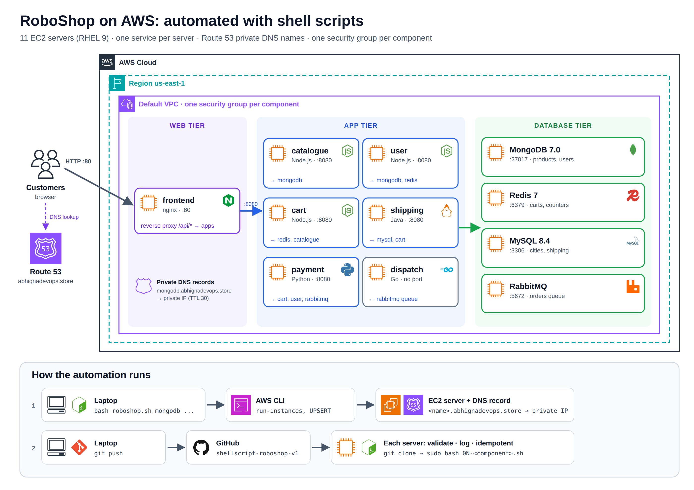
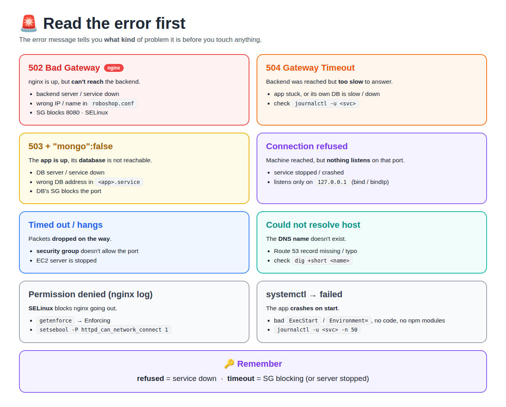

# RoboShop: 3-Tier Microservices on AWS, Automated with Shell Scripts

> Deploying the **RoboShop** e-commerce app (frontend, 6 microservices, 4 databases) on **AWS EC2** with **Bash** and the **AWS CLI**. One script creates the servers and DNS records, and one script per component installs and configures that service, with logging, validation and safe re-runs.



---

## Table of Contents

1. [What this project does](#what-this-project-does)
2. [Tech stack](#tech-stack)
3. [Repository structure](#repository-structure)
4. [Progress + notes for every script](#progress)
5. [Architecture](#architecture)
6. [Prerequisites](#prerequisites)
7. [Security groups](#security-groups)
8. [How to run](#how-to-run)
9. [Script design](#script-design)
10. [Verify each component](#verify-each-component)
11. [Problems I faced and how I fixed them](#problems-i-faced-and-how-i-fixed-them)
12. [Debugging](#debugging)
13. [Cost and cleanup](#cost-and-cleanup)
14. [Shell scripts vs real-world tools](#shell-scripts-vs-real-world-tools)
15. [What's next](#whats-next)
16. [Docs](#docs)

---

## What this project does

| Without scripts | With this repo |
|-----------------|----------------|
| Click in the AWS console to create each server, copy IPs into DNS by hand | `bash roboshop.sh mongodb redis mysql ...` creates the servers **and** the Route 53 records |
| SSH in and type 10-20 commands per server from a doc | `bash 02-redis.sh` installs and configures the whole component |
| Easy to miss a step; no record of what ran | Every step is **validated** (SUCCESS / FAILED) and **logged** with timestamps |
| Running twice breaks things ("user already exists") | Scripts are **idempotent**: a re-run SKIPS what already exists |

---

## Tech stack

| Area | Used |
|------|------|
| Cloud | AWS EC2 (`t3.micro`, RHEL 9), Route 53, Security Groups |
| Automation | Bash, AWS CLI (`run-instances`, `wait`, `describe-instances`, `change-resource-record-sets`), JMESPath `--query` |
| Web / proxy | Nginx (reverse proxy for `/api/*`) |
| App services | Node.js 24 (catalogue, user, cart, payment), Java (shipping), dispatch |
| Databases / queue | MongoDB 7.0, Redis 7, MySQL 8.4, RabbitMQ |
| Linux | `dnf` modules, systemd units, `sed`, users, logs |
| Source control | Git + GitHub (laptop → GitHub → each server) |

---

## Repository structure

```
shellscript-roboshop-v1/
├── roboshop.sh            # laptop: create EC2 instances + Route 53 records
├── 01-mongodb.sh          # mongodb server
├── 02-redis.sh            # redis server
├── 03-mysql.sh            # mysql server
├── 04-rabbitmq.sh         # rabbitmq server
├── 05-catalogue.sh        # catalogue server
├── mongo.repo             # MongoDB 7.0 repo (server + mongosh client)
├── rabbitmq.repo          # Erlang + RabbitMQ repos
├── catalogue.service      # systemd unit with a DOMAIN_NAME placeholder
└── docs/
    ├── scripts-walkthrough.md   # how every script works, line by line
    ├── troubleshooting.md       # problems I hit + fixes
    ├── debugging-guide.md       # which error → what to check, logs per server, real errors
    ├── interview-questions.md
    ├── servers/                 # one note per script: code, line by line, run, verify, problems
    ├── roboshop-journey.md      # manual → shell scripts → Git + CI/CD, every error as one story
    ├── traffic-flow-incoming-outgoing.md   # who calls whom: address files, SG rules, config changes
    └── images/
```

| File | Runs on | Does |
|------|---------|------|
| [roboshop.sh](roboshop.sh) | Laptop (AWS CLI) | Creates one EC2 instance per name, waits until running, UPSERTs the DNS record |
| [01-mongodb.sh](01-mongodb.sh) | mongodb | Repo → install MongoDB 7.0 → enable/start → `bindIp 0.0.0.0` → restart |
| [02-redis.sh](02-redis.sh) | redis | `dnf module` Redis 7 → `bind 0.0.0.0` + `protected-mode no` → enable/start |
| [03-mysql.sh](03-mysql.sh) | mysql | MySQL 8.4 → enable/start → root password → fix `root@localhost` → **login check** |
| [04-rabbitmq.sh](04-rabbitmq.sh) | rabbitmq | Repo → Erlang + RabbitMQ → enable/start → app user (**skips if it exists**) → permissions |
| [05-catalogue.sh](05-catalogue.sh) | catalogue | Node.js 24 → app user → download + unzip code → `npm install` → systemd service → load products |

---

## Progress

| # | Script | Component | Status | Run time (measured) | Explained (block by block) |
|---|--------|-----------|--------|---------------------|----------------------------|
| 00 | [roboshop.sh](roboshop.sh) | EC2 + Route 53 | ✅ Done | - | [📖 notes](docs/servers/00-roboshop-sh.md) |
| 01 | [01-mongodb.sh](01-mongodb.sh) | MongoDB 7.0 | ✅ Done | - | [📖 notes](docs/servers/01-mongodb.md) |
| 02 | [02-redis.sh](02-redis.sh) | Redis 7 | ✅ Done | 21 s | [📖 notes](docs/servers/02-redis.md) |
| 03 | [03-mysql.sh](03-mysql.sh) | MySQL 8.4.11 | ✅ Done (+ root@localhost bug found and fixed) | 40 s | [📖 notes](docs/servers/03-mysql.md) |
| 04 | [04-rabbitmq.sh](04-rabbitmq.sh) | RabbitMQ | ✅ Done, re-run safe | 36 s (re-run: 86 s, SKIPPING the user) | [📖 notes](docs/servers/04-rabbitmq.md) |
| 05 | [05-catalogue.sh](05-catalogue.sh) | Catalogue | ✅ Done: `/health` OK, 11 products, re-run safe | 63 s | [📖 notes](docs/servers/05-catalogue.md) |
| 06 | | User | ⏭️ Next | | |
| 07–10 | | Cart, Shipping, Payment, Frontend | ⏭️ Planned | | |
| - | | `common.sh` (shared functions) | ⏭️ Planned | | |

---

## Architecture

| Tier | Server | Port | Talks to |
|------|--------|------|----------|
| Web | frontend (nginx) | 80 | all apps on 8080 (`/api/<service>/`) |
| App | catalogue | 8080 | mongodb |
| App | user | 8080 | mongodb, redis |
| App | cart | 8080 | redis, catalogue |
| App | shipping | 8080 | mysql, cart |
| App | payment | 8080 | cart, user, rabbitmq |
| App | dispatch | - | rabbitmq |
| Data | mongodb / redis / mysql / rabbitmq | 27017 / 6379 / 3306 / 5672 | - |

**DNS:** every server gets a Route 53 record.

| Server | IP used | Record |
|--------|---------|--------|
| frontend | **Public** IP | `abhignadevops.store` |
| everything else | **Private** IP | `<name>.abhignadevops.store` |

Config files use **DNS names, not IPs**, so a re-created server only needs its DNS record updated (which `roboshop.sh` does).

**Automation flow:**

```
 LAPTOP                                AWS
 ① bash roboshop.sh mongodb  ────────▶ EC2 instance + Route 53 record (nothing installed yet)
 ② git push ───▶ GitHub
                   │
                   ▼ ③ ssh → sudo su - → git clone
               mongodb server ── ④ bash 01-mongodb.sh  (dnf, systemctl, sed run HERE)
```

---

## Prerequisites

| Need | Value in this project |
|------|-----------------------|
| AWS CLI configured on the laptop | `aws configure` (access key with EC2 + Route 53 permissions) |
| AMI | `ami-0055977a6e828a4f4` (Redhat-9-DevOps-Practice, RHEL 9) |
| Instance type | `t3.micro` |
| Domain + Route 53 hosted zone | `abhignadevops.store`, nameservers at the registrar pointing to the **4 Route 53 NS** values |
| Security groups | `roboshop-common` + one `roboshop-<component>` per server (below) |
| On each server | `git` (`dnf install git -y`), run scripts as **root** |

---

## Security groups

Every instance gets **two** SGs: `roboshop-common` (SSH) + its own component SG (app port only).

| SG | Inbound |
|----|---------|
| **roboshop-common** | 22 from **My IP** only |
| roboshop-frontend | 80 from anywhere |
| roboshop-mongodb | 27017 from catalogue, user |
| roboshop-redis | 6379 from user, cart |
| roboshop-mysql | 3306 from shipping |
| roboshop-rabbitmq | 5672 from payment, dispatch · 15672 from My IP |
| roboshop-catalogue | 8080 from frontend, cart |
| roboshop-user | 8080 from frontend, payment |
| roboshop-cart | 8080 from frontend, shipping, payment |
| roboshop-shipping / payment | 8080 from frontend |
| roboshop-dispatch | none (only connects out) |

> Sources are **SGs, not IPs**: a re-created server keeps working without rule changes. SSH lives in **one** SG, so a new home IP = one rule to update.

---

## How to run

**1. Laptop: create servers + DNS**

```bash
git clone https://github.com/Abhignadumpala/shellscript-roboshop-v1.git
cd shellscript-roboshop-v1
bash roboshop.sh mongodb redis mysql rabbitmq catalogue
```

```
Creating instance: mongodb
mongodb ID: i-0b336bf4b51e709ea
mongodb IP: 172.31.0.236
DNS updated: mongodb.abhignadevops.store -> 172.31.0.236
```

**2. Each server: install the component** (order matters: databases first, then apps)

```bash
ssh ec2-user@<public-ip>
sudo su -
dnf install git -y
git clone https://github.com/Abhignadumpala/shellscript-roboshop-v1.git
cd shellscript-roboshop-v1          # run from here: scripts copy .repo/.service files from this folder
bash 01-mongodb.sh                  # 02-redis.sh on redis, 03-mysql.sh on mysql, ...
```

| Order | Script | Needs first |
|-------|--------|-------------|
| 1 | `01-mongodb.sh`, `02-redis.sh`, `03-mysql.sh`, `04-rabbitmq.sh` | nothing |
| 2 | `05-catalogue.sh` | mongodb (loads products into it) |
| 3 | user, cart, shipping, payment | their databases / services |
| 4 | frontend | all app services |

**3. Watch a long step:** the script's output goes to the log, so open a 2nd SSH session:

```bash
tail -f /var/log/roboshop/<script>.sh.log
```

**Changed a script?** Push from the laptop, then `git pull` on the server and run it again (safe: idempotent).

---

## Script design

Every component script follows the same pattern:

```bash
user_id=$(id -u)
logs_folder="/var/log/roboshop"
logs_file="${logs_folder}/${0}.log"          # /var/log/roboshop/02-redis.sh.log

if [ $user_id -ne 0 ]; then                    # must be root (dnf, systemctl)
    echo "Please run this script with sudo access.."
    exit 1
fi

timestamp(){ date +"%F %T"; }

validate(){                                    # $1 = exit code, $2 = step name
    if [ $1 -ne 0 ]; then
        echo -e "$(timestamp) [ERROR] ${2}..${R}FAILED${N}" | tee -a $logs_file
        exit 1                                 # stop at the first failure
    else
        echo -e "$(timestamp) [INFO] ${2}..${G}SUCCESS${N}" | tee -a $logs_file
    fi
}

dnf install redis -y &>> $logs_file            # noisy output → log only
validate $? "installing redis"                 # clean SUCCESS/FAILED line → screen + log
...
echo "$(timestamp) [INFO] script completed in $SECONDS seconds" | tee -a $logs_file
```

| Feature | How | Why |
|---------|-----|-----|
| **Root check** | `id -u` must be `0` | `dnf` and `systemctl` need root |
| **Validation** | `validate $? "<step>"` after each step | Stop at the first failure with a clear message |
| **Logging** | `&>> $logs_file`, `tee -a`, `[INFO]`/`[ERROR]`, timestamps | Screen stays clean; full output kept for debugging; `grep ERROR` works |
| **Timing** | `$SECONDS` | Measured run time per script |
| **Idempotency** | `id roboshop` / `rabbitmqctl list_users \| grep -qw roboshop` → create or **SKIPPING**; `rm -rf /app/*` before unzip; `countDocuments()` → load products only if `0` | Same result no matter how many times I run it |
| **Own files after `cd`** | `script_dir=$(dirname "$(realpath "$0")")` at the top, `cp $script_dir/catalogue.service ...` | `cd /app` would make relative paths fail; works from any folder |
| **Restart at the end** | `systemctl restart <service>` + `validate $?` | `start` ignores changes if the service is already running |
| **Placeholders** | `mongodb.DOMAIN_NAME` in the unit file + `sed -i "s/DOMAIN_NAME/$domain_name/"` on the **copy** | Domain set in one variable; repo file stays unchanged |
| **Validate the result** | `mysql -uroot -p... -e "SELECT VERSION();"` after setting the password | An exit code of 0 doesn't prove the password works (see bug below) |

Full line-by-line explanation per script: [docs/servers/](docs/servers/README.md)

---

## Verify each component

| Server | Command | Expected |
|--------|---------|----------|
| mongodb | `ss -lntp \| grep 27017` | `0.0.0.0:27017` |
| redis | `redis-cli ping` | `PONG` |
| mysql | `mysql -uroot -pRoboShop@1 -e 'SELECT VERSION();'` | `8.4.11` |
| rabbitmq | `rabbitmqctl list_users` | `roboshop` listed |
| catalogue | `curl localhost:8080/health` | `{"app":"OK","mongo":true}` |
| catalogue | `curl localhost:8080/products` | 11 products |


---

## Problems I faced and how I fixed them

| Problem | Cause | Fix |
|---------|-------|-----|
| `ERROR 1045 Access denied for 'root'@'localhost'` although the script said SUCCESS | `mysql_secure_installation --set-root-pass` set the password only on `root@'%'`; `root@localhost` stayed **empty** (proved via `mysql.user`) | `ALTER USER 'root'@'localhost' ...` + a **login-check** step in the script |
| Re-running `04-rabbitmq.sh` failed at `add_user` | User already exists → non-zero exit → validate stops | Check first with `grep -qw`, else **SKIPPING** (tested: 2nd run passes) |
| Re-running `05-catalogue.sh` looked frozen | `unzip` asked "replace?" with output hidden in the log | `rm -rf /app/*` before unzip |
| `cp catalogue.service` → No such file | Ran after `cd /app` | `script_dir=$(dirname "$(realpath "$0")")` at the top |
| 2nd run would load products twice | `master-data.js` ran every time | `countDocuments()` → load only if `0`, else **SKIPPING** |
| Re-run ignored a changed service file | `systemctl start` does nothing on a running service | End with `systemctl restart catalogue` + `validate` |
| `sed: unterminated 's' command` | Missing the 3rd `/` | `"s/DOMAIN_NAME/$domain_name/"` |
| Route 53 got the literal text `$IP` | Variables don't expand inside single quotes | `'"Value": "'$IP'"'` |
| `script completed in  seconds` | `$seconds` instead of the built-in `$SECONDS` | Bash is case-sensitive |
| Old AMI / SG IDs from class not found | IDs belong to another account or were deregistered | Use my own AMI ID and SG **names** |

All 17 with details: [docs/troubleshooting.md](docs/troubleshooting.md)

---

## Debugging

When something doesn't work, follow the request path one hop at a time. The guide covers:

- **Error → meaning → what to check**: 502, 503, 504, connection refused vs timeout, NXDOMAIN, No route to host, SELinux, MySQL 2003.
- **The same 6-step checklist** every time: server running → service running → listening → answers locally → reachable from the caller → caller's config.
- **Which log is on which server**, and what you can find in each.
- **Real errors** from class, with screenshots and fixes.



Full guide: [docs/debugging-guide.md](docs/debugging-guide.md)

---

## Cost and cleanup

| Action | Effect |
|--------|--------|
| **Stop** all servers after practice | No compute cost while stopped (EBS storage still billed) |
| Start again | **Private IP stays** → DNS + configs still work. **Public IP changes** → new SSH address |
| Terminate + re-create | New private IP → `roboshop.sh` UPSERTs the DNS record |

---

## Shell scripts vs real-world tools

| Task | Here (shell) | Real-world tool |
|------|--------------|-----------------|
| Create servers, SGs, DNS | `roboshop.sh` | **Terraform** |
| Install and configure | `0N-<component>.sh` | **Ansible** |
| Package the app | Install on each server | **Docker** |
| Run many services | One EC2 per service | **Kubernetes** |
| Databases | Install on EC2 | **RDS, DocumentDB, ElastiCache, Amazon MQ** |
| Passwords | In the script (practice only) | **Secrets Manager / SSM Parameter Store** |

> The passwords in these scripts (`RoboShop@1`, `roboshop123`) are lab practice values from the course, not real credentials.

---

## What's next

- [ ] `06-user.sh`, `07-cart.sh`, `08-shipping.sh`, `09-payment.sh`, `10-frontend.sh`
- [ ] Move the shared header and functions into `common.sh`
- [ ] Practice debugging by breaking things on purpose (SG rule, stopped service, wrong DNS name)

---

## Docs

| Doc | What's inside |
|-----|---------------|
| [Server notes](docs/servers/README.md) | **One note per script**: [roboshop.sh](docs/servers/00-roboshop-sh.md) · [mongodb](docs/servers/01-mongodb.md) · [redis](docs/servers/02-redis.md) · [mysql](docs/servers/03-mysql.md) · [rabbitmq](docs/servers/04-rabbitmq.md) · [catalogue](docs/servers/05-catalogue.md) |
| [Scripts walkthrough](docs/scripts-walkthrough.md) | Every script explained, with run screenshots |
| [Troubleshooting](docs/troubleshooting.md) | Problems I hit, causes, fixes |
| [Debugging guide](docs/debugging-guide.md) | Which error → what to check, logs per server, real class errors |
| [Interview questions](docs/interview-questions.md) | Short Q&A for revision |
| [RoboShop journey](docs/roboshop-journey.md) | Manual → shell scripts → Git + CI/CD: every error, fix and lesson as one story |
| [Traffic flow: incoming & outgoing](docs/traffic-flow-incoming-outgoing.md) | Who calls whom: which address goes in which file, SG rules, config changes, side by side per server |

Learning notes (day by day): [devops-notes](https://github.com/Abhignadumpala/devops-notes)
