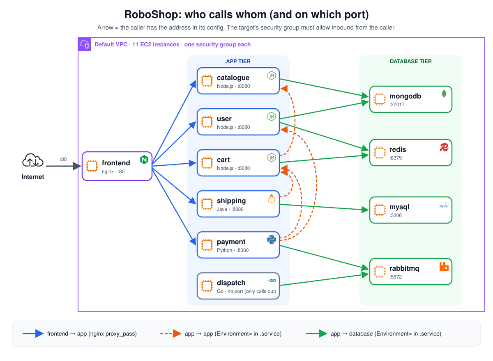

# RoboShop: 3-Tier Microservices on AWS, Automated with Shell Scripts

> Deploying the **RoboShop** e-commerce app (frontend, 6 microservices, 4 databases) on **AWS EC2** with **Bash** and the **AWS CLI**. One script creates the servers and DNS records, and one script per component installs and configures that service, with logging, validation and safe re-runs.

📖 **Every script explained block by block, with hands-on screenshots and troubleshooting:** [roboshop-project-v1-shellscript-notes](https://github.com/Abhignadumpala/roboshop-project-v1-shellscript-notes)





---

## What this project does

| Without scripts | With this repo |
|-----------------|----------------|
| Click in the AWS console to create each server, copy IPs into DNS by hand | `bash roboshop.sh mongodb redis ...` creates the servers **and** the Route 53 records |
| SSH in and type 10–20 commands per server | `bash 02-redis.sh` installs and configures the whole component |
| Easy to miss a step; no record of what ran | Every step is **validated** (SUCCESS / FAILED) and **logged** with timestamps |
| Running twice breaks things | Scripts are **idempotent**: a re-run SKIPS what already exists |
| Manual build: **4–5 hours** | With scripts: **about 2 hours** |

---

## Tech stack

| Area | Used |
|------|------|
| Cloud | AWS EC2 (`t3.micro`, RHEL 9), Route 53, Security Groups |
| Automation | Bash, AWS CLI (`run-instances`, `wait`, `describe-instances`, `change-resource-record-sets`) |
| Web / proxy | Nginx (reverse proxy for `/api/*`) |
| App services | Node.js 24, Java, Python, Go |
| Databases / queue | MongoDB 7.0, Redis 7, MySQL 8.4, RabbitMQ |
| Linux | `dnf` modules, systemd units, `sed`, users, logs |

---

## Scripts

| Script | Runs on | What it does | Run time | Explained |
|--------|---------|--------------|----------|-----------|
| [roboshop.sh](roboshop.sh) | laptop | Creates EC2 instances + Route 53 records | – | [📖](https://github.com/Abhignadumpala/roboshop-project-v1-shellscript-notes/tree/main/00-roboshop) |
| [01-mongodb.sh](01-mongodb.sh) | mongodb | MongoDB 7.0, open to other servers | – | [📖](https://github.com/Abhignadumpala/roboshop-project-v1-shellscript-notes/tree/main/01-mongodb) |
| [02-redis.sh](02-redis.sh) | redis | Redis 7, `bind` + `protected-mode` | 21 s | [📖](https://github.com/Abhignadumpala/roboshop-project-v1-shellscript-notes/tree/main/02-redis) |
| [03-mysql.sh](03-mysql.sh) | mysql | MySQL 8.4, root password + login check | 40 s | [📖](https://github.com/Abhignadumpala/roboshop-project-v1-shellscript-notes/tree/main/03-mysql) |
| [04-rabbitmq.sh](04-rabbitmq.sh) | rabbitmq | RabbitMQ + app user (re-run safe) | 36 s | [📖](https://github.com/Abhignadumpala/roboshop-project-v1-shellscript-notes/tree/main/04-rabbitmq) |
| [05-catalogue.sh](05-catalogue.sh) | catalogue | Node.js app, systemd service, products loaded once | 63 s | [📖](https://github.com/Abhignadumpala/roboshop-project-v1-shellscript-notes/tree/main/05-catalogue) |
| [06-user.sh](06-user.sh) | user | Node.js app, sessions in Redis, users in MongoDB | 109 s | [📖](https://github.com/Abhignadumpala/roboshop-project-v1-shellscript-notes/tree/main/06-user) |
| [07-cart.sh](07-cart.sh) | cart | Node.js app, cart in Redis, prices from catalogue | 99 s | [📖](https://github.com/Abhignadumpala/roboshop-project-v1-shellscript-notes/tree/main/07-cart) |
| [08-shipping.sh](08-shipping.sh) | shipping | Java + Maven build, cities loaded into MySQL once | 216 s | [📖](https://github.com/Abhignadumpala/roboshop-project-v1-shellscript-notes/tree/main/08-shipping) |
| payment, dispatch, frontend | | | | next |

Support files: [mongo.repo](mongo.repo) · [rabbitmq.repo](rabbitmq.repo) · [catalogue.service](catalogue.service) · [user.service](user.service) · [cart.service](cart.service) · [shipping.service](shipping.service)

---

## How to run

**1. Laptop: create servers + DNS**

```bash
git clone https://github.com/Abhignadumpala/shellscript-roboshop-v1.git
cd shellscript-roboshop-v1
bash roboshop.sh mongodb redis mysql rabbitmq catalogue
```

**2. Each server: install the component** (databases first, then apps)

```bash
ssh ec2-user@<public-ip>
sudo su -
dnf install git -y
git clone https://github.com/Abhignadumpala/shellscript-roboshop-v1.git
cd shellscript-roboshop-v1
bash 01-mongodb.sh          # 02-redis.sh on redis, 03-mysql.sh on mysql, ...
```

**Watch a long step:** `tail -f /var/log/roboshop/<script>.sh.log` in a 2nd SSH session.

---

## Key features

| Feature | How |
|---------|-----|
| **Validation** | `validate $? "<step>"` after each step → SUCCESS, or FAILED and stop |
| **Logging** | Timestamped `[INFO]` / `[ERROR]` lines in `/var/log/roboshop/<script>.log` |
| **Idempotency** | Check before creating (`id roboshop`, `list_users \| grep -qw`, `countDocuments()`) → SKIPPING on re-run |
| **DNS, not IPs** | `DOMAIN_NAME` placeholder + `sed`; Route 53 private records for every backend |
| **Restart at the end** | `systemctl restart` + `validate`, so every change is loaded |
| **Validate the result** | e.g. MySQL login check after setting the password |

---

## Problems I solved

| Problem | Fix |
|---------|-----|
| MySQL said SUCCESS but `root@localhost` had **no password** | `ALTER USER` + a login-check step |
| Re-runs failed ("user already exists") or loaded data twice | Check first → SKIPPING |
| `cp catalogue.service` failed after `cd /app` | `script_dir=$(dirname "$(realpath "$0")")` at the top |
| Redis refused other servers | Change **both** `bind` and `protected-mode` |
| Re-run ignored a changed service file | `restart`, not `start` |

All problems and fixes: [troubleshooting](https://github.com/Abhignadumpala/roboshop-project-v1-shellscript-notes/blob/main/docs/troubleshooting.md)

---

## What's next

- [ ] `06-user.sh` … `11-frontend.sh`
- [ ] Shared functions in `common.sh`
- [ ] Move to **Git + CI/CD**: tests and automatic deploys on every push
